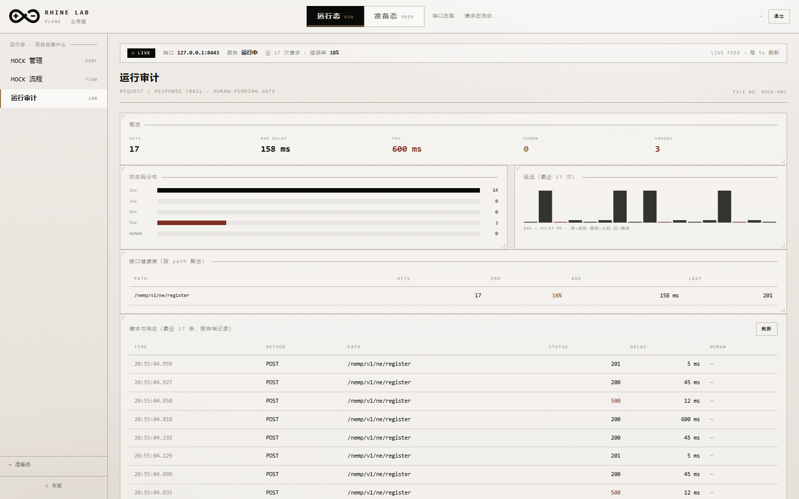
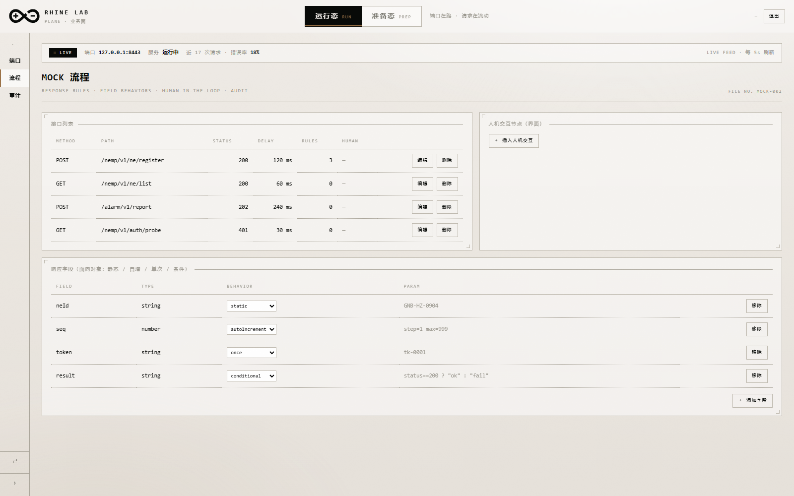
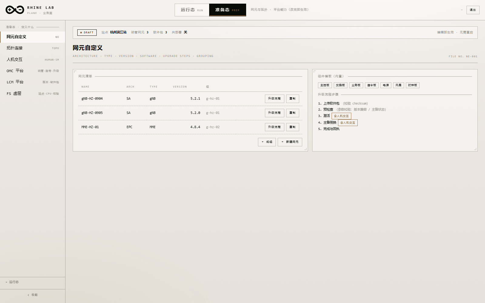
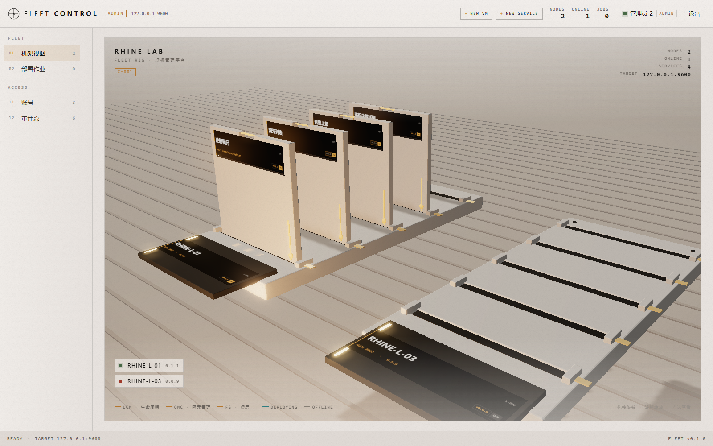
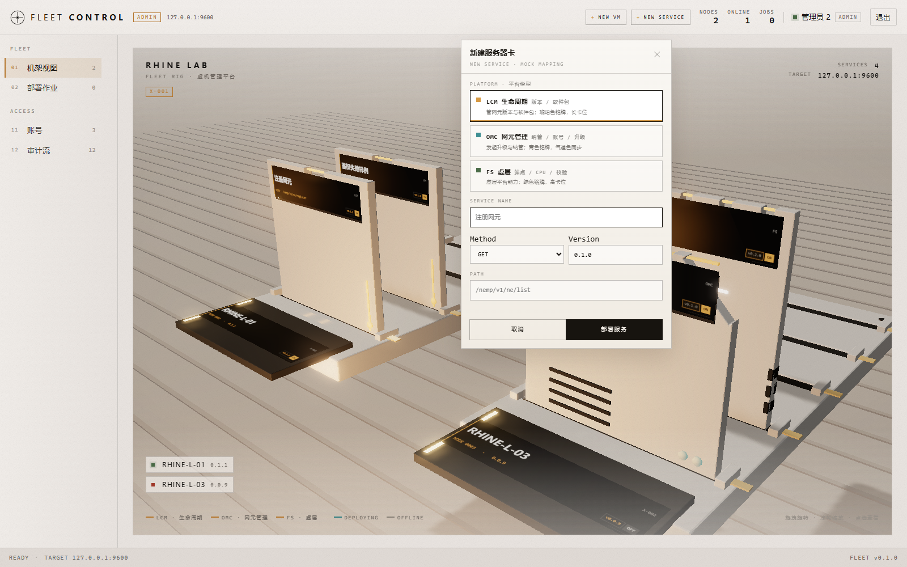
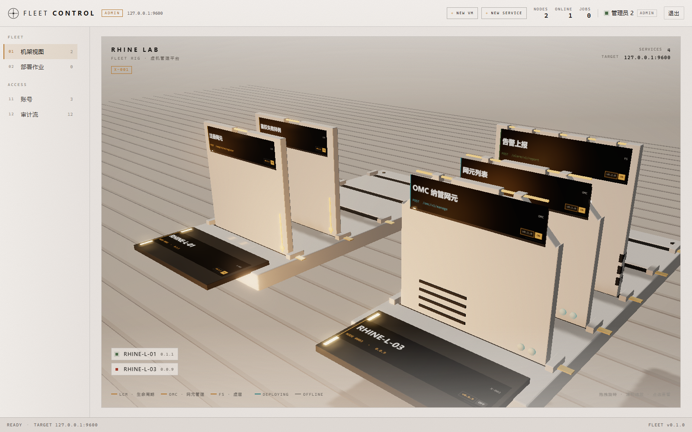

# 业务面演示手册 · RHINE LAB PLANE

> 要照着讲？看 **[demo-script.md](demo-script.md)**（逐幕操作脚本 + 16 张截图）。

> 面向"有机响应"的 MoC 平台：**LCM 管版本 → OMC 管升级 → 升级的元组件仍是网元**，
> 全流程带人机交互（human-in-the-loop），风格统一为米白档案纸 + 黑墨细线 + 琥珀信号色。

- 入口：`http://127.0.0.1:9600/business/plane.html`
- 登录：L 端需要凭据（默认 `admin / rhine-admin-2026`）；W 端 `RHINE_AUTH=off` 自动跳过
- 数据：`console/data/*.json`（端点 / 映射规则 / 网元 / 网元组 / 软件包 / 平台配置 / 升级任务 / 人机模板）

---

---

## 0.1 一键启动

```powershell
# 推荐（PowerShell，自动起两个实例并打开页面）
.\start-demo.ps1

# 双击或 cmd
start-demo.cmd
```

脚本行为：

1. 检查 `console/target/debug/rhine-agent.exe` 是否存在（不存在会提示编译命令）
2. 9600 未监听 → 后台起 L 端（`RHINE_AUTH=on`，需登录）；9601 未监听 → 起 W 端（免登录）
3. 等到 9600 就绪（最多 20s）→ 自动打开 `business/plane.html`

| 端 | 地址 | 凭据 |
|---|---|---|
| L 端 | http://127.0.0.1:9600/business/plane.html | `admin / rhine-admin-2026` |
| W 端 | http://127.0.0.1:9601/business/plane.html | 免登录 |
| 看板 | http://127.0.0.1:9600/business/index.html | 同 L 端 |

停止：`Get-Process rhine-agent | Stop-Process -Force`

> 桌面壳：`console/desktop/business/`（Tauri 2）已指向 `business/plane.html`，
> CSP 放行 9600/9601。打包需要 WebView2 + `cargo tauri build`，不在日常编译链里。
## 0. 两个工作区（不是六个平级平台）

顶栏是工作区切换器（运行态 / 准备态）。切换会换掉整套左侧导航与状态条，并把地址栏改成 `#/<layer>/<view>`。

```
运行态 · 现在在跑什么        端口在跑、请求在流动
  MOCK 管理   注册监听 → 证书 → 能力 → 启停
  MOCK 流程   规则编辑器 + 人机交互 + 审计
  运行审计    真实请求流水（202 可一键放行）
        ▲ 执行
        │ 定义
准备态 · 定义什么            网元与拓扑、平台能力（改完即生效）
  网元自定义 / 拓扑连接 / 人机交互 / OMC / LCM / FS
```

顶部两颗按钮是工作区切换（运行态 ⇄ 准备态）；左侧导航只显示当前工作区的台，底部 `→ 准备态 / ← 运行态` 可跨区。

---

## 1. MOCK 管理（运行态）

| 操作 | 说明 | 接口 |
|---|---|---|
| 填 Host / Port | 本机 IP + 端口 | — |
| 保存端点 | 写入端点 | `PATCH /api/business/endpoints/:id` |
| 挂载能力 | NEMP / NEF / ALARM / PERF / FM 多选 | 同上（capabilities） |
| 生成证书 | 签发演示自签证书（CN + SAN + 序列号 + PEM） | `POST /api/business/endpoints/:id/cert` |
| 开启服务 | `SERVICE 运行中` | `PATCH ... { enabled: true }` |

四步进度条会随状态点亮；右侧「端点状态（服务端）」显示 ID / Endpoint / Service / Certificate / Capabilities，证书全文直接可读。

---

## 2. MOCK 流程（运行态）

### 2.1 接口列表 → 编辑

列出所有 mapping（method / path / status / delay / rules / human 数），点「编辑」进入规则编辑器。

### 2.2 规则编辑器

- **响应基础**：HTTP Status 下拉（200/201/202/204/400/401/403/404/500/503）+ Delay 毫秒
- **响应字段（对象化管理）**：每行 = 字段名 + 类型下拉（string/number/boolean/object/array）+ 行为下拉 + 参数
  - `静态值`：原样输出，支持 `{{req.xxx}}` 插值
  - `自增`：`step` 递增，超过 `max` 回卷
  - `单次生效`：首次输出，之后该字段消失
  - `条件表达式`：`req.mode=="fast"?true:false`
- **人机交互节点**：提示文案、超时、选项（`Option → Effect(continue/hold/abort) → Set field`）
- 「保存规则」→ `PATCH /api/business/mappings/:id/rules`

### 2.3 引擎行为（真实生效）

```
命中规则 → 若 human.state = pending → 202 {humanPending, prompt, options} + 头 x-rhine-human: pending
         否则按字段生成 JSON → 延迟 delay_ms → 返回 status
```

实测样本（同一接口连续两次）：
```json
第 1 次 {"code":"0","data":{"neId":"GNB-01","ok":true},"seq":1,"token":"tk-once"}
第 2 次 {"code":"0","data":{"neId":"GNB-02","ok":false},"seq":2}
```

### 2.4 运行审计

每次命中落库（method / path / status / delay / human），`HUMAN 202` 行带**「确认」**按钮 → 放行后后续请求返回真响应。

---

## 3. 网元自定义（准备态）

- 列表：名称 / 架构 / 类型 / 版本 / 所属组
- **新建网元**：`POST /api/business/elements`（自动带 5 步升级流程，激活与主备倒换默认挂人机交互）
- **复制网元**：`POST /api/business/elements/:id/copy`
- **成组**：`POST /api/business/groups`
- **升级流程 / 参数校验可编辑**：进入「升级流程」→ 改步骤名、点开关挂/摘人机交互、增删步骤与校验规则 → 「保存到网元」(`PATCH /api/business/elements/:id`)
- 改版本时后端自动把旧版本压入 `prev_versions`

---

## 4. 拓扑连接（准备态）

- **2D**：SVG 正交连线，站点 → 网元组 → 网元，三层按钮切换，双击下钻，hover 档案卡
- **3D**：Blender 资产（站点平台 / 网元组托板 / 网元立卡 / 组件芯片），斜上 45° 可拖拽缩放
  - 卡面铭牌显示 `NE-0001 / gNB-HZ-0904 / v5.2.1`
  - 点选高亮邻接（琥珀连线加粗、非邻接压暗）
  - 双击网元 → 组件级（中心立卡 + 环形组件芯片）

---

## 5. 人机交互（准备态）

状态机可视化 + 可编辑：

- 状态表：ID / Label / Tone（signal / ink / danger / muted），可增删改
- 操作结果表：`Option → Effect → To state → Set field`，可增删改
- 「保存状态机」→ `PATCH /api/business/human-template`
- **该模板会真实影响升级任务弹出的人工确认选项**

默认：`确认继续/continue → RESOLVED`、`稍后处理/hold → PENDING`、`终止升级/abort → EXPIRED`

---

## 6. OMC 平台（准备态）

- **纳管网元**：点 chip 切换，写回 `platform.omc_elements`
- **站点**：名称 + 角色（primary / secondary）可编辑保存，后续任务与 LCM 升级都用它
- **账号**：填名字 + 选角色（运维 / 只读 / 管理员）→ 创建，授权范围取当前纳管网元
- **创建升级任务** → 进入时间线

### 6.1 升级任务时间线

5 段：`上传软件包 → 预检查与参数校验 → 激活 → 主备倒换 → 完成与回执`

- **前两段无人工 → 自动推进**（服务端 3s 一拍，前端 3s 轮询）
- **激活 / 主备倒换带人机交互** → 到点停下，琥珀卡片内联显示提示与选项
- 选项效果：`continue` 推进 / `hold` 挂起 / `abort` 失败归零

实测：创建后 6~10 秒内自动从 20% 走到 60%，停在「激活」；确认后继续到「主备倒换」；再确认到 100%。

---

## 7. LCM 平台（准备态）

- 管理的网元与当前 / 旧版本
- 软件包仓库：包名 / **类型** / **所属网元** / **厂商** / **版本**
- 与 OMC **共部署开关**（`platform.co_deploy`）
- **「升级」按钮** → `POST /api/business/packages/:id/upgrade`
  - 以「包所属网元当前版本」为 from、包版本（或指定版本）为 to
  - 直接生成一套 5 段升级任务并跳到时间线 ← **LCM↔OMC 的联动点**

---

## 8. FS 虚层平台（准备态）

- 平台配置：CPU 数量 / 主站点 / 备站点 / 平台版本（可 PATCH）
- **软件包校验流程（可执行）**：`POST /api/business/platform/fs/verify`
  - checksum → 签名 → 兼容性（仓库为空则失败）→ 主备站点一致性（同名则失败）
  - **失败即中断**，每步记录 `PASS/FAIL + note + 时间`
- 平台升级流程 6 步（展示用「演练一次」触发人工确认界面）

---

## 9. 数据流总览

```
MOCK 端点 ──→ /mock/* 引擎 ──→ 响应（规则字段 + 延迟 + 状态码）
                    │                 └─ 人机门 202 → 审计页确认 → 200
                    └─→ 审计（MockHit 环形缓冲 200 条）

网元（属性/版本/流程/校验/组件/组）
   ├─→ 拓扑 2D/3D（数据驱动）
   └─→ 组织成 网元组 → OMC 纳管

人机交互模板（状态 + 操作结果）
   └─→ 升级任务的人工确认选项

LCM 软件包（归属网元 + 版本）──→ 升级任务（from=网元当前版本, to=包版本）
                                    └─→ 时间线（自动推进 / 人工门拦截）

FS：平台版本 + 校验流程（可执行，失败中断）
```

---

## 10. 常用验证命令

```powershell
# 端点
curl http://127.0.0.1:9600/api/business/endpoints -b cookie
# 规则
curl -X PATCH .../api/business/mappings/map-0011/rules -d '{"fields":[...]}'
# 打 mock
curl -X POST http://127.0.0.1:9600/mock/demo/v1/rule -d '{"neId":"GNB-01","mode":"fast"}'
# 任务
curl http://127.0.0.1:9600/api/business/tasks
# FS 校验
curl -X POST http://127.0.0.1:9600/api/business/platform/fs/verify
```

---

## 11. 关键实现位置

| 层 | 文件 |
|---|---|
| 页面骨架 | `console/ui/business/plane.html` |
| 业务面逻辑 | `console/ui/business/plane.js`（13 个视图函数） |
| 样式 | `console/ui/business/plane.css` |
| 3D 拓扑 | `console/ui/business/plane-topo3d.js` |
| 拓扑资产 | `console/assets/blender/topo_assets_v1.py` → `console/ui/business/assets/topo_*.glb` |
| 后端模型 | `console/crates/core/src/model.rs` |
| 存储 | `console/crates/core/src/store.rs` |
| 接口与引擎 | `console/apps/agent/src/main.rs` |

---

## 12. 场景快照与教学场景库

MOCK 管理页右侧「场景快照（导出 / 导入）」：

| 操作 | 说明 |
|---|---|
| 预置场景下拉 + 载入 | 一键切到某套教学场景（会覆盖当前数据） |
| ↓ 导出场景 | 下载 `rhine-scene-*.json`（约 13 KB） |
| ↑ 导入场景 | 选本地 JSON 导入，提示「已导入 N 条 ✓」 |

快照内容：端点（含证书/能力）、网元（属性/版本/流程/校验/组件）、网元组、软件包、平台配置（站点/CPU/共部署）、人机模板、MOCK 映射（含 fields 与 variants）。

接口：

```bash
GET  /api/business/export        # 导出（登录即可）
POST /api/business/import        # 导入（管理员 + CSRF），整体覆盖，保留用户与会话
```

内置场景（`console/ui/business/scenes/`）：

| 文件 | 场景 | 要点 |
|---|---|---|
| `baseline.json` | 基线：单站点三网元 | 标准演示起点 |
| `co-deploy.json` | 双站点共部署 | CPU 32、共部署开启、版本 5.3.0 待升级 |
| `fault-drill.json` | 故障演练 | 注入 500 规则、慢速兜底 400ms、15s 人机超时 |
| `index.json` | 索引 | 下拉列表的数据源 |

> 换机器演示：把 `scenes/*.json` 或自己导出的快照拷过去，导入即可 1:1 复现。
---

## 0.2 便携发行版（免安装）

```powershell
node console/scripts/make-dist.mjs      # 生成 dist/rhine-mock-console-1.0.0/
```

产物结构：

```
dist/rhine-mock-console-1.0.0/
  启动.cmd                一键起两个后端 + 打开桌面业务面
  停止.cmd
  rhine-agent.exe         后端（9.7 MB）
  Rhine 业务面.exe        桌面应用（12.1 MB，内嵌整套 UI）
  ui/                     静态前端（浏览器模式）
  data/                   数据文件（可备份替换）
  docs/                   演示手册 + 逐幕脚本 + 截图
  README.txt
```

实测（从 dist 目录独立运行）：9600/9601 均监听、浏览器 `plane.html → 200`、
`/api/meta.authRequired=false`、桌面壳加载「业务面 · RHINE LAB PLANE」。

> 桌面壳通过 WebView2 远程调试端口取证：`WEBVIEW2_ADDITIONAL_BROWSER_ARGUMENTS=--remote-debugging-port=9222`，
> 用 CDP 可读到完整 DOM（包含从 9601 拉到的端点数据），说明桌面应用与本机 agent 已打通。
---

## 0.3 桌面壳取证（无交互桌面环境）

CI / 远程会话下无法截屏时，用 WebView2 远程调试端口读取真实 DOM：

```powershell
$env:WEBVIEW2_ADDITIONAL_BROWSER_ARGUMENTS = '--remote-debugging-port=9222'
Start-Process "dist/rhine-mock-console-1.0.0/Rhine 业务面.exe"
node console/scripts/check-desktop.mjs
```

输出示例：

```json
{ "title": "业务面 · RHINE LAB PLANE", "view": "MOCK 管理",
  "ink": "#080a08", "line": "#aaa59a", "accent": "#9b7247",
  "nav": 9, "cards": 3 }
```

注意：桌面壳连的是本机 **9601（W 端，免登录）**，未启动 9601 时会停在登录门（`nav: 0`）。
---

## 0.4 桌面壳自绘标题栏

桌面壳（`console/desktop/business`）关闭了系统边框（`decorations: false`），改用页面内的自绘控制：

| 元素 | 实现 |
|---|---|
| 拖动区 | `.pl-top` 带 `data-tauri-drag-region`（仅 Tauri 下注入） |
| 按钮 | 右上角 `— / □ / ×`，调用 `plugin:window|minimize / toggle_maximize / close` |
| 浏览器 | `html` 不带 `is-tauri`，`.pl-winctl` 自动隐藏，仍是「退出」按钮 |
| 权限 | `core:window:allow-start-dragging / allow-minimize / allow-toggle-maximize / allow-close` |

实测（WebView2 CDP）：`is-tauri=true`、拖动区存在、3 个按钮可见、`minimize` 与 `close` 均生效（关闭后进程退出）。
---

## 0.5 管理面交互规范（虚机视图）

**一条铁律：悬停是详情，点击是操作。** 两者不重复、不重叠。

| 交互 | 元素 | 行为 |
|---|---|---|
| 悬停对象 | `.rig-tip`（跟随光标、`pointer-events:none`） | 只读详情：Model / 方法·路径 / 版本（落后标琥珀）/ 状态 / 命中 / 所属虚机 |
| 点击对象 | `.rig-modal`（右侧固定停靠，`right:22px; top:92px`） | 操作面板：抬头 + 事实行 + ACTIONS 四键（启用 / 停用 / 更新版本 / 共享） |
| 面板开着再悬停**别的**对象 | 两者并存 | 详情卡自动靠左放置（`tip.right ≤ panel.left`），绝不重叠 |
| 悬停**面板里的那个**对象 | 详情卡隐藏 | 面板已经写着同样信息，避免重复 |
| 点空白（画布内且未悬停任何对象） | 关闭面板 | 拖拽旋转不触发（位移 > 6px 判定为拖拽） |
| Esc | 关闭面板 | — |

修复前的问题（用户反馈）：悬停卡与点击弹窗内容高度重复；点击弹窗浮在鼠标位置，会和悬停卡、以及 app.js 的旧内联面板（`#rigPanel`）三块叠在一起。

修复动作：
1. `.rig-modal` 从「跟随点击点」改为「右侧固定停靠」；
2. 删掉 `pointerup` 里重复打开面板的那段（`rig:select` 已经负责）；
3. `placeTip()` 读取面板左边界做避让；
4. 面板打开且悬停同一对象时隐藏详情卡；
5. app.js 机架选中不再渲染内联面板（`renderRigPanel(type, null)`），操作入口唯一。
---

## 0.6 删除操作（服务 / 虚机）

删除是**两段确认**：第一次点击按钮变成深红「确认删除？ · 再点一次」，4 秒内再点才真正下发；超时自动复原，避免误删。

| 位置 | 对象 | 接口 | 交互 |
|---|---|---|---|
| 管理面 · 机架视图 | 服务（主板） | `DELETE /api/business/mappings/:id` | 悬停/点选服务板 → 操作面板「删除服务」 |
| 管理面 · 机架视图 | 虚机（服务器） | `DELETE /api/admin/nodes/:id` | 点选虚机 → 操作面板「删除虚机」 |
| 业务面 · MOCK 流程 | 接口 | `DELETE /api/business/mappings/:id` | 接口列表行内「删除」 |

删除成功后：面板关闭 → 右下角 toast 报出对象名 → 3D 场景与列表**自动重新拉数据**（不需要刷新页面）。

行为约定：

* 删服务只删这一个接口，虚机不动；
* 删虚机只删这台虚机，其上的服务不级联删除，会重新分配到其余虚机（`delete_node` 返回 `removed_services: 0`）；
* 两者都会写审计日志（`mapping.delete` / `node.delete`，级别 warn）。

实测（管理面 CDP）：`DELETE admin/nodes/node-0006 → 200`，toast「已删除虚机 DEL-VM-TEST」，节点列表 5 → 4，3D 板卡 5 → 4。
业务面：`DELETE business/mappings/map-0014 → 200`，列表 5 → 4 行。

> 顺带修掉一个隐性 bug：同一浏览器里若被另一个页面重新登录过，`sessionStorage` 里的旧 csrf 会失效，所有写操作 403（表现为"点了删除报权限不足"）。现在 `ensureAuth()` 以 `/api/auth/me` 返回的 csrf 为准；管理面的删除接口也带 403 → 取 csrf → 重试一次。

---

## 0.7 侧边栏折叠与工作区切换（2026-11 改版）







原来「运行态 / 准备态」只是同一份导航的两个高亮分组，本质还是页签；现在改成**两个工作区**：

| 维度 | 运行态 | 准备态 |
|---|---|---|
| 导航 | MOCK 管理 / MOCK 流程 / 运行审计（3 个） | 网元自定义 / 拓扑 / 人机交互 / OMC / LCM / FS（6 个） |
| 状态条 | `LIVE`：端口、服务启停、近 N 次请求、错误率、待人工数；每 5s 自动刷新（只替换状态条，不打断表单） | `DRAFT`：站点、纳管网元数、软件包数、共部署开关 |
| 语义 | 现在在跑什么 | 定义什么（改完即生效） |
| 地址 | `#/runtime/<view>` | `#/prep/<view>` |

侧边栏折叠：

- 入口：rail 底部 `‹ 收起` / `› 展开`；快捷键 `Ctrl/B`（macOS `⌘B`）
- 宽度：216px → 60px，只显示两字缩写（端口 / 流程 / 审计 / 网元 / 拓扑 / 人机 / OMC / LCM / FS），`title` 出全名
- 记忆：`localStorage['rhine.plane.rail']`
- 折叠后底部保留 `⇄`（跨工作区）与 `›`（展开）

实测（1600×1000）：展开 `216px 1384px`，折叠 `60px 1540px`；切到准备态后 hash=`#/prep/elements`，浏览器后退回到 `#/runtime/audit`；直接打开 `#/prep/topo` 会落在拓扑视图。

---

## 0.8 管理面：新建服务器卡时的「平台类型」

原来新建服务只有 Name / Method / Path，卡匣属于哪个平台由 `scene.js` 按 path 猜、猜不到就按 id 哈希分 —— 于是同名同形的三张卡看不出区别，也说不清是哪套平台的服务。

现在：

1. **数据层**：`Mapping.kind`（`LCM | OMC | FS`），`NewMapping.kind` 可写、`PatchMapping.kind` 可改；旧数据缺字段时 `#[serde(default = "default_kind")]` 回落 `LCM`。
2. **表单层**：新建服务器卡顶部加 `PLATFORM · 平台类型` 三选，每项有色点、中文名、一行说明：
   - **LCM 生命周期**（琥珀）：版本 / 软件包
   - **OMC 网元管理**（青）：纳管 / 账号 / 升级
   - **FS 虚层**（绿）：站点 / CPU / 校验
   选中后隐藏域同步、Name 的 placeholder 也跟着变（登记网元版本 / 纳管网元 / 查询站点信息）。
3. **表现层**：铭牌 accent、灯带 emissive 按 kind 三色；左下角图例写成 `LCM · 生命周期 / OMC · 网元管理 / FS · 虚层`，各带色块。

实测：

```
PATCH map-0002 {kind:"OMC"} → 200，3D 里该卡 kind=OMC
POST /api/business/mappings {kind:"OMC", name:"OMC 纳管网元"} → 200 map-0016 kind=OMC
toast：已部署 OMC 服务「OMC 纳管网元」v0.1.0
sceneKinds：OMC:/omc/v1/manage, LCM:/nemp/v1/ne/register, OMC:/nemp/v1/ne/list, FS:/alarm/v1/report
```

## 0.9 管理面顶栏动作按钮不再重叠

`+ NEW VM / + NEW SERVICE` 原来绝对定位在 `#rig` 上（`top:14px; right:16px`），和顶栏右侧的 `NODES / ONLINE / JOBS` 统计叠在一起，最右还被窗口裁掉。

现在按钮放进顶栏 `.top__right` 里的 `#topActs`，与统计之间用 1px 竖线分隔：

```html
<div class="top__acts" id="topActs"></div>
<div class="top__stat"><span>NODES</span>…</div>
```

实测（1600×1000）：动作区 `left 1033 → right 1218`，统计起始 `left 1234`，**不重叠**且 `right ≤ innerWidth`（不再被裁）。同时把 3D HUD 里重复的 `NODES / ONLINE` 去掉，只保留顶栏没有的 `SERVICES / TARGET`。





