# 演示脚本 · RHINE LAB 业务面

> 面向讲课/交付的**逐幕操作脚本**：每一幕给出「先做什么 → 看哪里 → 说什么」。
> 截图目录：`console/docs/img/`（16 张，按编号对应各幕）。

启动：

```powershell
.\start-demo.ps1        # 拉起 9600 / 9601 并打开业务面
# 登录 admin / rhine-admin-2026
```

演示前建议载入「基线」场景：`MOCK 管理 → 场景快照 → 基线：单站点三网元 → 载入`。

---

## 幕 0 · 开场：这不是六个平台

**操作**：停在首屏，鼠标划过顶部两颗按钮（运行态 / 准备态）。

**看点**：顶栏两个工作区——`运行态`（状态条是 LIVE：端口、请求数、错误率）与 `准备态`（状态条是 DRAFT：站点、纳管、软件包）。切换时会换掉左侧整套导航，地址栏也跟着变 `#/runtime/...` ↔ `#/prep/...`。

**台词**：
> 这套东西不是六个并列的平台，而是**两个工作区**：运行态（端口在跑、请求在流动），
> 下面一层是准备态（网元、拓扑、平台能力）。下面定义，上面执行。

---

## 幕 1 · MOCK 管理：把本机变成一个网元

**操作**：`MOCK 管理` → 改 Port → `保存端点` → 勾选 `NEMP / NEF` → `生成证书` → `开启服务`

**看点**：四步进度条依次点亮；右侧「端点状态」里 Endpoint / Service / Certificate / Capabilities 全变。

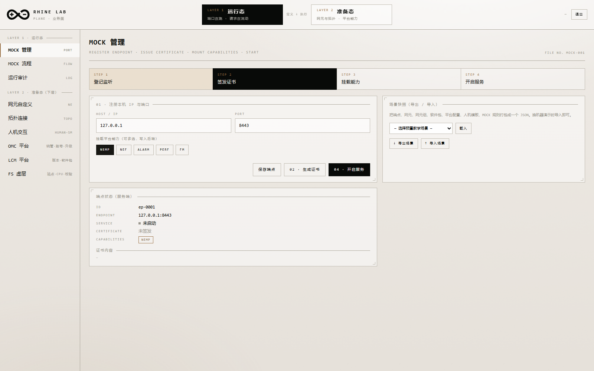

**台词**：
> 第一步先把本机注册成一个 mock 端口，给它签一张证书、挂上平台能力，再开服务。
> 右边这些值不是写死的展示，是服务端真实状态。

---

## 幕 2 · MOCK 流程：一个接口，多种响应

**操作**：`MOCK 流程` → 点任一接口的「编辑」

**看点**：三段结构
1. 响应基础：Status 下拉 + Delay
2. **多规则匹配**：`条件 / Status / Delay / 响应体 / 备注`
3. 响应字段：字段名 + 类型下拉 + 行为下拉（静态 / 自增 / 单次生效 / 条件）

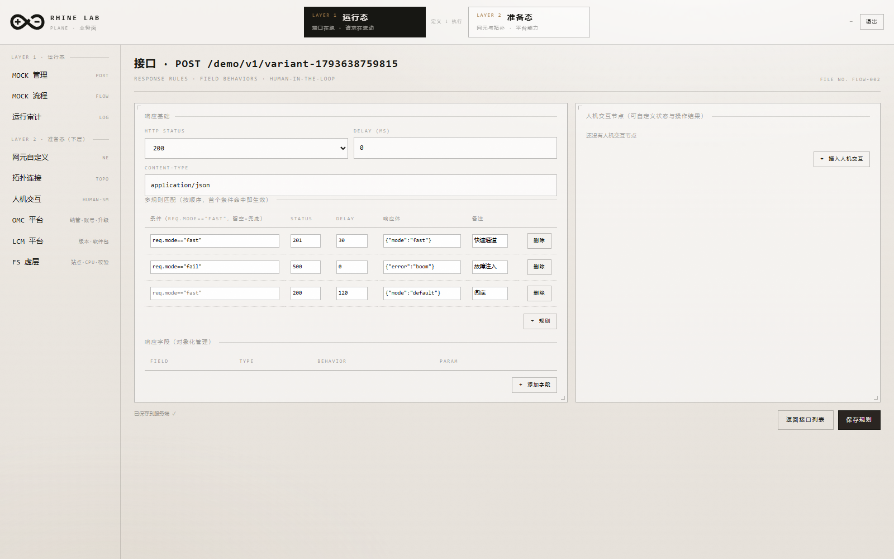

**台词**：
> 一个接口可以按条件返回不同结果：`req.mode=="fast"` 走 201、`"fail"` 走 500，
> 兜底那条配了 120ms 延迟。字段层面还能自增、只生效一次、按条件算。

**可现场验证**（可选，终端里）：

```powershell
curl -X POST http://127.0.0.1:9600/mock/<path> -H "Content-Type: application/json" -d '{"mode":"fast"}'
# → 201  {"mode":"fast","ok":true}   响应头 x-rhine-rule: req.mode=="fast"
```

---

## 幕 3 · 运行审计：请求真的来了

**操作**：`运行审计` → 点「刷新」

**看点**：概览（HITS / AVG / P95 / HUMAN / ERRORS）+ 状态码分布 + 延迟条形 + 接口健康度 + 明细表。

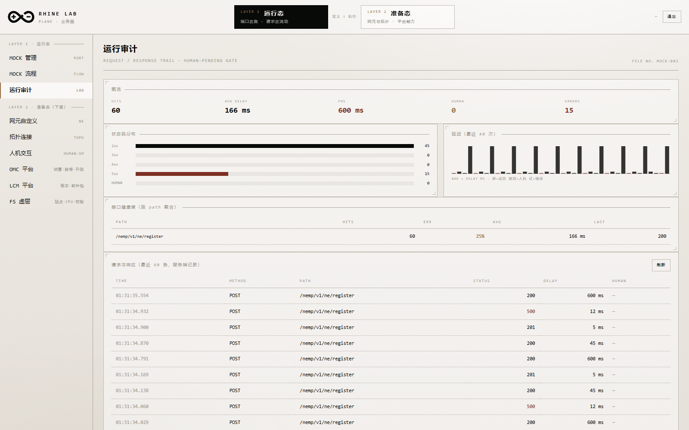

**台词**：
> 这是真实的请求流水。P95 超过 500ms 会标红，错误率按接口聚合。
> 带 `HUMAN 202` 的行说明请求被人机交互挡住了，点「确认」就放行。

**演示人机门**：让某一行的状态是 202 → 点「确认」→ 再打一次接口 → 返回真实响应。

---

## 幕 4 · 网元自定义：流程与校验都能改

**操作**：`网元自定义` → 某网元「升级流程」

**看点**：5 步流程可改名字、点开关挂/摘人机交互、可增删；右侧参数校验规则三列可编辑；改完「保存到网元」。

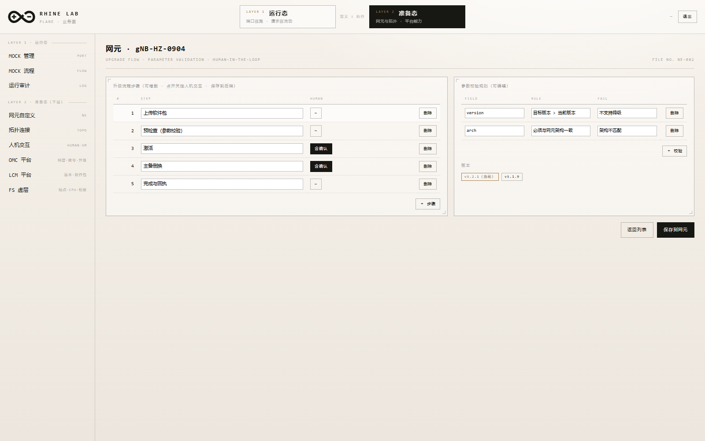

**台词**：
> 升级流程本身就是数据。第 3、4 步挂了人工确认，所以后面任务走到那里会停下来等人。

**新建网元**：点「＋ 新建网元」→ 填名字、选架构/类型/版本/软件/所属组、点选组件 → 创建。

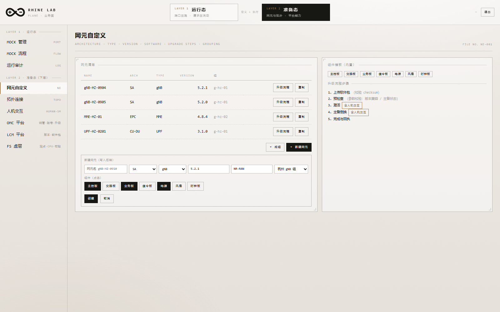

---

## 幕 5 · 拓扑：三个视角看同一份数据

**操作**：`拓扑连接` → 依次点 `站点/网元` `网元组` `组件级`，再切 `3D`

**看点**
- 站点/网元：站点平台 → 组托板 → 网元立卡（卡面写着自己的名字与版本）
- 网元组：选中组居中，组内网元立在托盘上，后排是同级的其他组（可点切换）
- 组件级：中心网元 + 5 种造型芯片（主控板/交换板/业务板/电源/风扇）

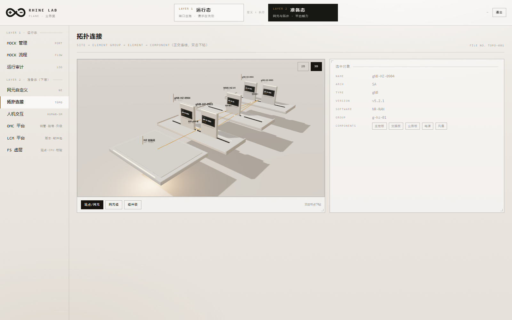
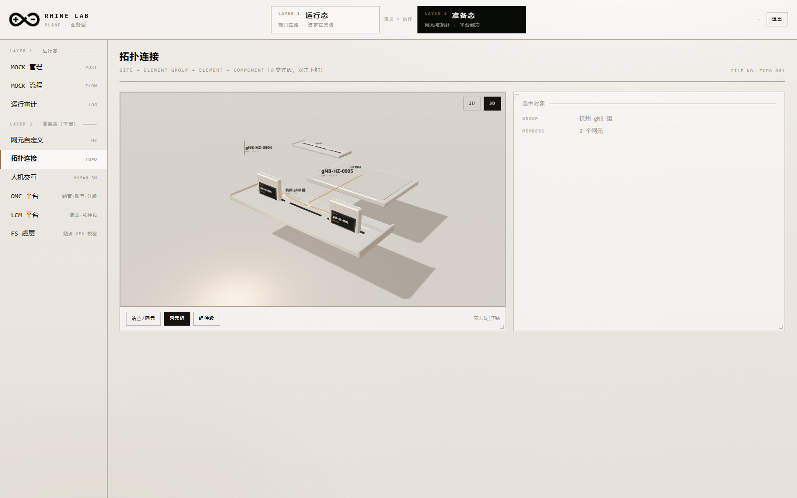
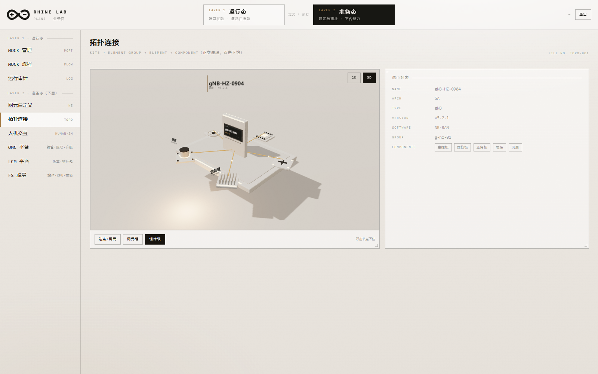

**近景**：拖近看卡面铭牌 `NE-0001 / gNB-HZ-0904 / v5.2.1`。

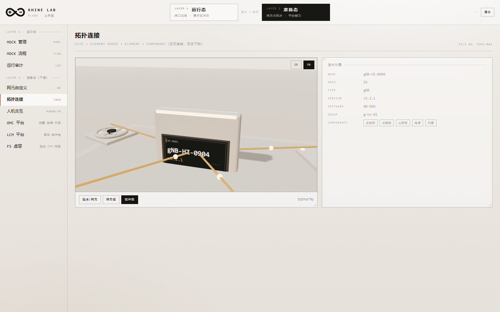

**点选效果**：点一个网元，它的相邻节点保持不透明、其余降到 60%；连到它的那条线变成琥珀色，
流光点变亮变快并放大，其它线的流光点直接隐藏。双击网元下钻到组件级。

**台词**：
> 拓扑是自由做的——这些板子、立卡、芯片都是 Blender 出的资产，不是平面图。
> 连线上的流光单向从父流向子（带小箭头），表示数据在流动。双击网元就下钻到组件级。

---

## 幕 6 · 人机交互：状态与结果都能自定义

**操作**：`人机交互`

**看点**：状态表（ID / Label / Tone）+ 操作结果表（Option → Effect → To state → Set field），可增删改，保存后**真实影响**升级任务弹出的人工确认选项。

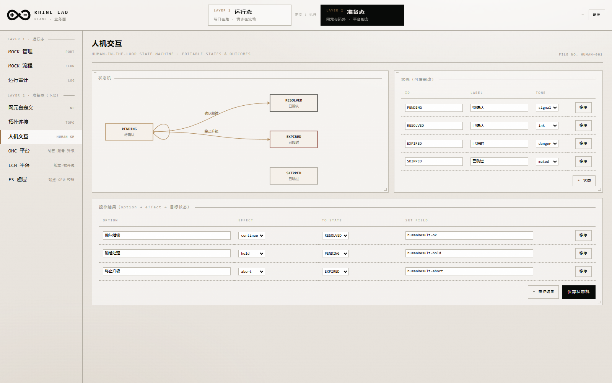

**台词**：
> 这里是"剧本"：每种操作结果对应什么效果（继续 / 挂起 / 终止）。
> 改完保存，后面任务里弹出的按钮就跟着变。

---

## 幕 7 · OMC：纳管、账号、任务

**操作**：`OMC 平台`

**看点**
1. 纳管网元 chip（点选切换，写回后端）
2. 站点名 + 角色（primary/secondary）
3. 账号表：点某账号 → 下方出现「授权范围」→ 点网元 chip 勾选 → 保存授权
4. 右侧任务卡片（进度 / 卡点 / 站点 / 版本）

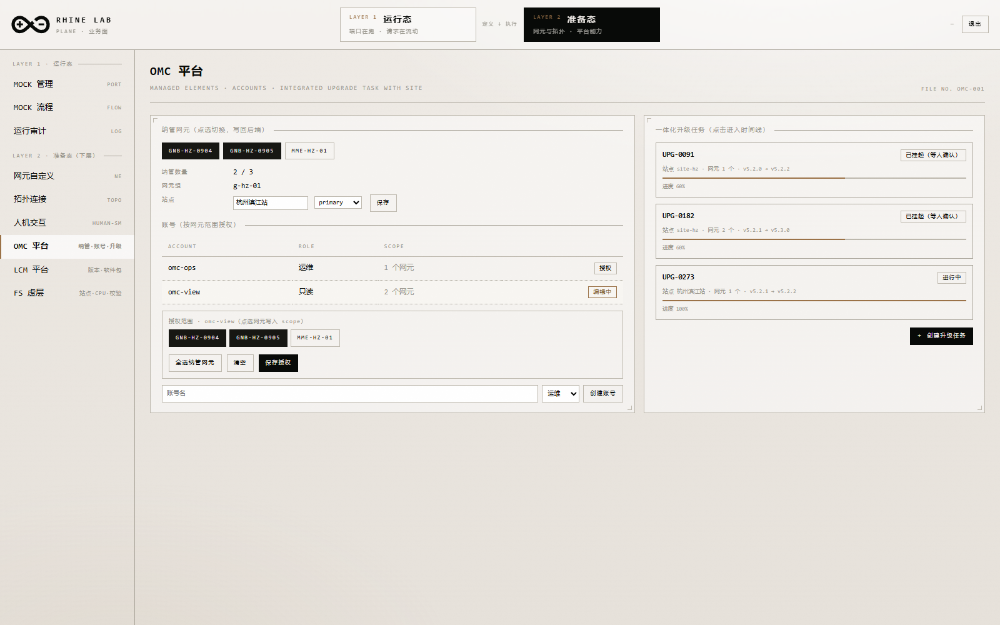

**台词**：
> 账号是有范围的——只读账号只能看见授权给它的那几个网元。

---

## 幕 8 · LCM：版本在这里管，升级在 OMC 走

**操作**：`LCM 平台`

**看点**：左列网元当前/旧版本；右列软件包仓库（包名/类型/所属网元/厂商/版本）；底部「登记软件包」表单；「与 OMC 共部署」开关。

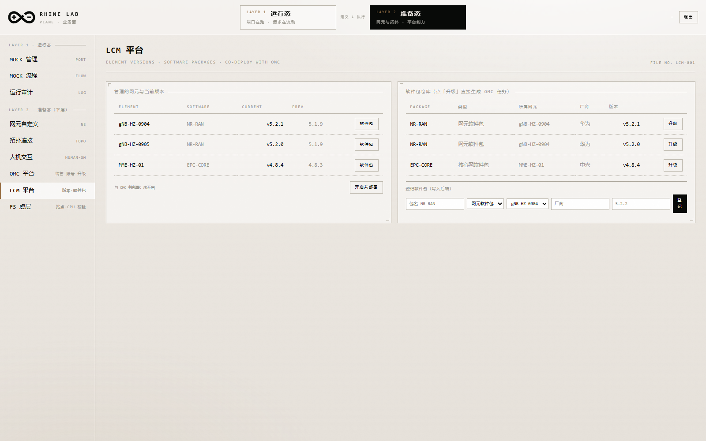

**联动演示**：点某个包右侧的「升级」→ 自动生成一套 5 段升级任务并跳到时间线。

**台词**：
> LCM 管版本、OMC 管升级，两者对接点就在这个「升级」按钮：
> 用包所属网元的当前版本当 from、包版本当 to，直接生成任务。

---

## 幕 9 · 升级任务：会自己走，也会停下来等人

**操作**：任务时间线页

**看点（自动推进）**：新任务从 20% 开始，6~10 秒内自己走到 60%，然后停在「3. 激活」——因为那里挂了人工确认。

**看点（人工门）**：琥珀框内联在阶段里，三个选项带 `EFFECT · continue / hold / abort`。点「确认继续」→ 推进到第 4 段（又一个人工门）→ 再确认 → 100%。

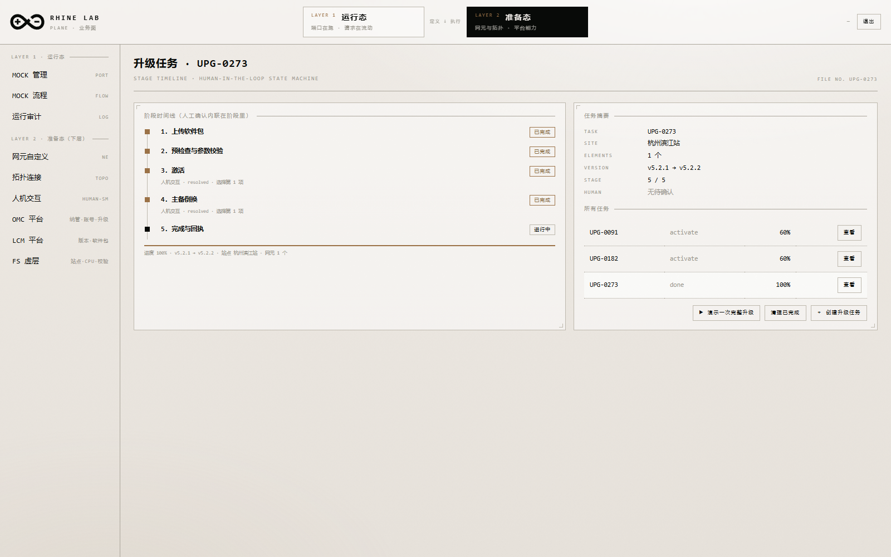

**看点（超时）**：另一条任务放着不管，60 秒后人工确认变红 `HUMAN · EXPIRED`，阶段挂起；点「重新发起确认」回到 pending。

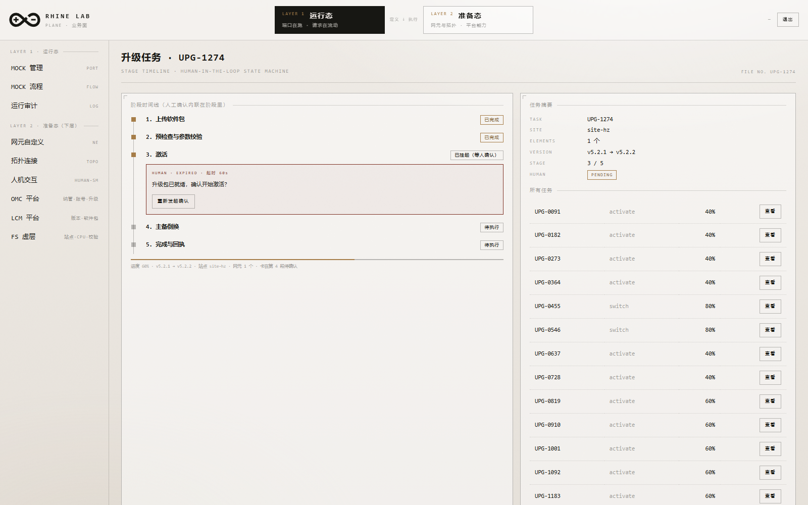

**台词**：
> 没有人参与的地方它自己往前走，需要人确认的地方就停下来。
> 超时不确认会挂起，但可以重新发起——这就是"有机"的节奏。

**一键演示**：点「▶ 演示一次完整升级」，25 秒自己跑完全流程（自动推进 + 自动点确认），适合录屏。

---

## 幕 10 · FS 虚层：一个独立的小闭环

**操作**：`FS 虚层`

**看点**
1. 平台配置（CPU / 主站点 / 备站点 / 平台版本）可编辑保存
2. 「执行校验」→ 逐步 PASS/FAIL，**失败即中断**（如主备站点同名）
3. 两条流程（校验 / 升级）都能增删步骤并保存

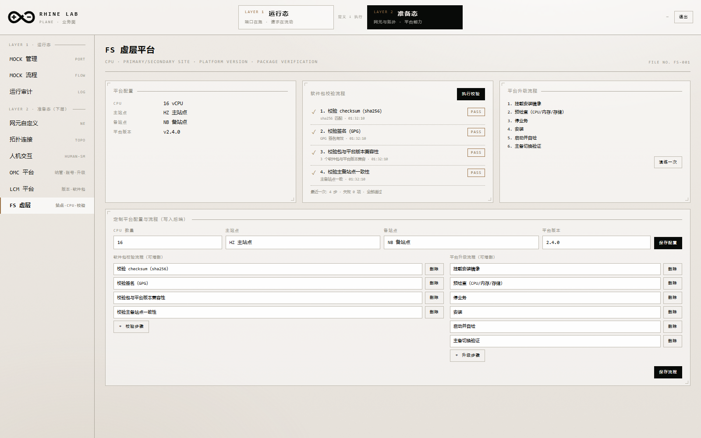

**台词**：
> FS 是个比较独立的平台，特点是"校验会真的失败"——失败就停在那一步，不会假装通过。

---

## 幕 11 · 三套场景，一键切换

**操作**：`MOCK 管理` → 场景快照 → 选「双站点共部署」→ 载入

**看点**：CPU 32、共部署开启、网元改名 BJ-*、版本 5.3.0 待升级。

再载入「故障演练」：注入 500 规则 + 400ms 慢兜底 + 15s 人机超时。

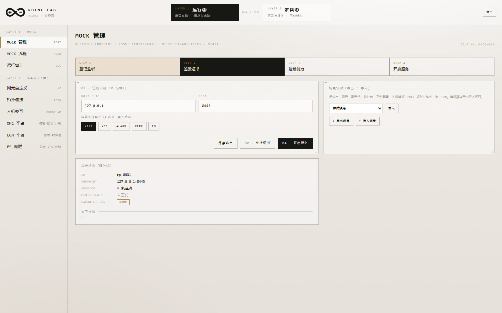

**台词**：
> 三套场景对应三种讲法：标准演示、共部署联动、故障与超时。
> 也可以「↓ 导出场景」把它带走，到别的机器「↑ 导入场景」1:1 复现。

---

## 收尾：一页总结

| 层 | 台 | 一句话 |
|---|---|---|
| 运行态 | MOCK 管理 | 把本机变成一个能应答的网元端口 |
| 运行态 | MOCK 流程 | 一个接口多种响应，可条件、可自增、可挡人 |
| 运行态 | 运行审计 | 请求真的来了，能看到、能放行 |
| 准备态 | 网元自定义 | 属性/版本/流程/校验/组件都是数据 |
| 准备态 | 拓扑 | 站点→组→网元→组件，2D/3D 双视角 |
| 准备态 | 人机交互 | 状态与结果自定义，直接影响任务 |
| 准备态 | OMC | 纳管 + 账号范围 + 升级任务 |
| 准备态 | LCM | 版本与软件包，一键喂给 OMC |
| 准备态 | FS | 独立小闭环，校验会真的失败 |

**一句话收束**：
> 下面定义"应该发生什么"，上面验证"实际发生了什么"，中间由人机交互把它们咬合起来。

---

## 附：常用命令

```powershell
# 起服务
.\start-demo.ps1
# 停服务
Get-Process rhine-agent | Stop-Process -Force
# 重编译（改过 Rust）
cd console; cargo build --offline
# 手动起两个端
$env:RHINE_PORT=9600; $env:RHINE_AUTH=on; $env:RHINE_UI=ui; $env:RHINE_DATA=data/agent.json; .\target\debug\rhine-agent.exe
```
